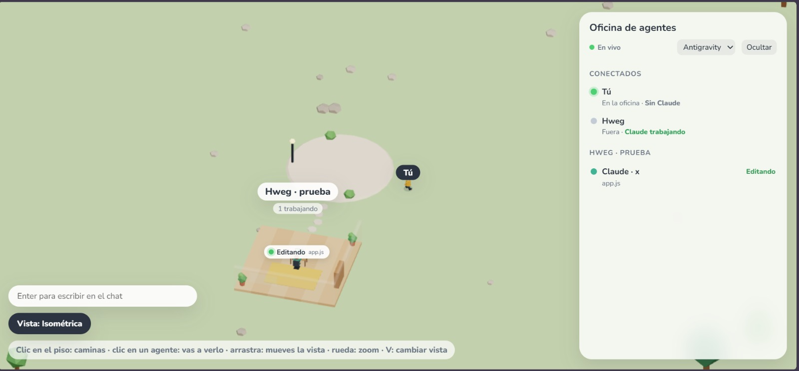

# Oficina de agentes



Una oficina 3D low poly, en vivo, de lo que hacen tus sesiones de Claude Code y
sus agentes en **todos** tus proyectos:

- una sala por proyecto y un escritorio por agente (los subagentes llevan gorra);
- cada uno muestra lo que hace: leyendo, editando, corriendo un comando,
  pensando, delegando, dormido…;
- cuando alguno necesita tu permiso o te hace una pregunta, se levanta y camina
  hasta tu avatar con una burbuja.

No gasta tokens: solo recibe los eventos que Claude Code ya produce (hooks).
Todo es local (`127.0.0.1`); no se publica nada.

## Requisitos

- **Node.js 18 o más nuevo** (no usa dependencias: no hace falta `npm install`).
- **Claude Code** 2.1 o más nuevo (para los hooks `async`).
- **curl** en la terminal (viene con Windows 10/11, macOS y Linux).
- En Windows, **Git Bash** instalado: Claude Code lo usa para correr los hooks.
- Un navegador moderno con WebGL. La página carga three.js desde un CDN, así
  que la primera vez necesita internet.

## Cómo correrlo

1. Descarga el proyecto:

   ```
   git clone https://github.com/hweg000/oficina-agentes.git
   cd oficina-agentes
   ```

2. Arranca la oficina y déjala abierta:

   ```
   npm start
   ```

   Abre **http://localhost:3950** en el navegador. Si el puerto está ocupado,
   usa otro con `OFICINA_PORT=3960 npm start` (y cambia el puerto también en
   los hooks del paso 3).

3. Conecta Claude Code: pega el bloque `hooks` de la sección
   [Conectar Claude Code](#conectar-claude-code-hooks-globales) en tu
   `~/.claude/settings.json` (en Windows: `C:\Users\<tu usuario>\.claude\settings.json`).
   Si ya tienes un bloque `hooks`, agrega estos eventos dentro del tuyo.

4. Usa Claude Code como siempre, en cualquier proyecto. Su sala aparece en la
   oficina con su primer evento.

Para verla funcionar sin Claude Code (con la oficina corriendo, en otra terminal):

```
npm run prueba     # pone un agente en cada estado y hace las transiciones (Ctrl+C limpia)
npm run demo       # eventos al azar sin fin, para verla moverse
npm test           # prueba del modelo de estado
```

## Controles

Hay tres vistas; se cambian con la tecla **V** o el botón "Vista" (abajo a la izquierda).

**Tercera y primera persona:** clic para mirar con el mouse, **W A S D** (o
flechas) para caminar, **Shift** para correr, **E** para hablar con el agente
de enfrente (si te busca, abre su tarjeta) y **Esc** para soltar el mouse.
Aquí no se atraviesan paredes ni escritorios.

**Isométrica:**

- **Clic en el piso:** tu avatar camina hacia allá y la cámara lo sigue.
- **Clic en un agente:** tu avatar va a verlo y ves su bitácora en el panel.
  Si ese agente te estaba esperando (permiso o pregunta), se abre su tarjeta
  con el texto completo y un botón **Abrir en Antigravity** (o VS Code, según el selector del panel) que enfoca la ventana
  de ese proyecto. La respuesta se da en Claude Code; la oficina solo muestra.
- **Arrastrar:** mueve la vista. **Rueda:** zoom.
- Los agentes que te buscan van a donde esté tu avatar.
- **G o botón "Gestos":** abre la ruleta de expresiones y gestos.
- **M o botón "Mapa":** cambia de mapa (se recuerda en tu navegador; también `?mapa=isla|ciudad`).

## Mapas

- **Isla:** la de siempre. Cada proyecto es una sala alrededor de la plaza, y si hay varios dueños cada uno tiene su barrio.
- **Ciudad:** calles con coches, plaza central, parques y torres. Cada usuario tiene su edificio con sus proyectos como oficinas adentro, y el edificio sube de pisos mientras más proyectos tenga. Al entrar apareces en la puerta de tu edificio.

Cada quien ve el mapa que eligió: los amigos que están en otro mapa no aparecen caminando en el tuyo.

## Eventos y Festividades del Año

El mapa se decora **100% automáticamente según la fecha actual** de tu reloj, sin menús invasivos en pantalla:

- **🎃 Halloween (Todo Octubre):** césped otoñal, farol con luz de calabaza, calabazas Jack-o'-lantern con vela parpadeante en la plaza y en las entradas de las salas, y murciélagos en los libreros.
  - **El Mero Día (31 de Octubre):** escenario especial en la plaza con un **Gran Caldero de Bruja** con poción verde brillante burbujeante, **lápidas de cementerio**, un **fantasma flotante translúcido** y banner festivo.
- **🌼 Día de Muertos (1 al 3 de Noviembre):** ramilletes de flores de cempasúchil en los caminos y plaza, tiras de papel picado festivo en las paredes de las salas y veladoras encendidas.
  - **El Mero Día (1 y 2 de Noviembre):** **Gran Altar Monumental de 3 niveles** en la plaza con arcos florales de cempasúchil, calaveritas de azúcar, pan de muerto tradicional, ofrendas y camino ceremonial de pétalos.
- **🎄 Navidad (Todo Diciembre y hasta el 6 de Enero):** manto de nieve blanca sobre toda la isla, copas de árboles con escarcha nevada, coronas navideñas de pino con lazo rojo en las salas y guirnaldas de luces parpadeantes.
  - **El Mero Día (24 y 25 de Diciembre):** **Gran Árbol Navideño Gigante** con estrella dorada giratoria, montaña de regalos con lazos de colores, un **Muñeco de Nieve (Frosty)** y **copos de nieve cayendo en tiempo real** por todo el mapa.

### Comando para abrir el menú de selección (Opcional):
Por defecto todo corre automáticamente según el calendario real sin botones en pantalla. Si deseas abrir el menú para probar o forzar una festividad:
- Escribe el comando **/eventos** (o **/menu**) en el chat (presiona `Enter` para abrir el chat y escribe `/eventos`).
- O en la consola del navegador: `window.eventos()`.
- O por URL: `?menu=1` o fijando fechas con `?fecha=10-31`, `?evento=navidad&especial=1`.

## Conectar Claude Code (hooks globales)

Agrega esto a `~/.claude/settings.json`. Los hooks son `async`: corren en
segundo plano y no frenan a Claude Code aunque la oficina esté apagada.

```json
"hooks": {
  "SessionStart":       [{ "hooks": [{ "type": "command", "async": true, "command": "curl -s -m 2 -H \"Content-Type: application/json\" --data-binary @- http://127.0.0.1:3950/evento >/dev/null 2>&1 || true" }] }],
  "SessionEnd":         [{ "hooks": [{ "type": "command", "async": true, "command": "curl -s -m 2 -H \"Content-Type: application/json\" --data-binary @- http://127.0.0.1:3950/evento >/dev/null 2>&1 || true" }] }],
  "UserPromptSubmit":   [{ "hooks": [{ "type": "command", "async": true, "command": "curl -s -m 2 -H \"Content-Type: application/json\" --data-binary @- http://127.0.0.1:3950/evento >/dev/null 2>&1 || true" }] }],
  "PreToolUse":         [{ "matcher": "*", "hooks": [{ "type": "command", "async": true, "command": "curl -s -m 2 -H \"Content-Type: application/json\" --data-binary @- http://127.0.0.1:3950/evento >/dev/null 2>&1 || true" }] }],
  "PostToolUse":        [{ "matcher": "*", "hooks": [{ "type": "command", "async": true, "command": "curl -s -m 2 -H \"Content-Type: application/json\" --data-binary @- http://127.0.0.1:3950/evento >/dev/null 2>&1 || true" }] }],
  "PostToolUseFailure": [{ "matcher": "*", "hooks": [{ "type": "command", "async": true, "command": "curl -s -m 2 -H \"Content-Type: application/json\" --data-binary @- http://127.0.0.1:3950/evento >/dev/null 2>&1 || true" }] }],
  "Notification":       [{ "hooks": [{ "type": "command", "async": true, "command": "curl -s -m 2 -H \"Content-Type: application/json\" --data-binary @- http://127.0.0.1:3950/evento >/dev/null 2>&1 || true" }] }],
  "Stop":               [{ "hooks": [{ "type": "command", "async": true, "command": "curl -s -m 2 -H \"Content-Type: application/json\" --data-binary @- http://127.0.0.1:3950/evento >/dev/null 2>&1 || true" }] }],
  "SubagentStart":      [{ "hooks": [{ "type": "command", "async": true, "command": "curl -s -m 2 -H \"Content-Type: application/json\" --data-binary @- http://127.0.0.1:3950/evento >/dev/null 2>&1 || true" }] }],
  "SubagentStop":       [{ "hooks": [{ "type": "command", "async": true, "command": "curl -s -m 2 -H \"Content-Type: application/json\" --data-binary @- http://127.0.0.1:3950/evento >/dev/null 2>&1 || true" }] }],
  "PreCompact":         [{ "hooks": [{ "type": "command", "async": true, "command": "curl -s -m 2 -H \"Content-Type: application/json\" --data-binary @- http://127.0.0.1:3950/evento >/dev/null 2>&1 || true" }] }]
}
```

Para desconectarla, borra ese bloque `hooks`.

## Barrio con amigos (Cloudflare Tunnel)

Una máquina hace de "barrio": corre la oficina y la publica con un túnel de
Cloudflare (por ejemplo `https://oficinas.tudominio.com` → `http://localhost:3950`).
Cada amigo manda sus eventos ahí con su propio token y todos ven las oficinas
de todos, con el nombre de cada quien en sus salas.

1. En la máquina del barrio, un token por amigo (inventa cadenas largas al azar):

   ```
   OFICINA_TOKENS="Ana:token-de-ana:ana@correo.com,Beto:token-de-beto:beto@correo.com" OFICINA_NOMBRE=Leo npm start
   ```

   El correo es con el que cada quien entra por Access: así su muñeco lleva el
   mismo nombre que sus salas. `OFICINA_NOMBRE` es tu nombre (tus hooks locales
   y tu muñeco cuando abres `localhost`). En PowerShell las variables se ponen
   antes: `$env:OFICINA_TOKENS = "..."`, `$env:OFICINA_NOMBRE = "Leo"`, luego `npm start`.

2. En Cloudflare Zero Trust → Access, protege el subdominio con una política
   **Allow** con los correos de tus amigos, y agrega otra aplicación para la ruta
   `/evento` con política **Bypass** (esa la protege el token).

3. Cada amigo agrega, en cada evento de sus hooks, un segundo comando junto al
   local (o en vez de él, si no corre la oficina en su compu):

   ```json
   { "type": "command", "async": true, "command": "curl -s -m 5 -H \"Content-Type: application/json\" -H \"Authorization: Bearer token-de-ana\" --data-binary @- https://oficinas.tudominio.com/evento >/dev/null 2>&1 || true" }
   ```

Lo que entra por el túnel (trae el header `cf-connecting-ip`) se trata como de
fuera: `/evento` exige token, `/crudo` no existe, y `/eventos` y `/estado` llegan
sin rutas, comandos, textos de permisos ni bitácora.

Quien tenga la página abierta aparece como un muñeco con su nombre y los demás
lo ven caminar. Cada dueño tiene su barrio (su placita y sus salas) alrededor de
la plaza del centro; con un solo dueño todo queda como siempre. Cuando un agente
pide permiso, camina hasta el muñeco de **su** dueño (si no tiene la página
abierta, se queda en su escritorio). **Enter** abre el chat: los mensajes salen
en la lista y como globo sobre quien habla.

Ojo: el hook manda el evento **completo** (rutas, comandos, lo que se leyó o
escribió) a la máquina del barrio. Ahí no se guarda, pero quien la corre lo
recibe y lo ve sin filtrar en su `localhost`.

## Depurar

- `http://localhost:3950/estado`: lo que la oficina cree que pasa.
- `http://localhost:3950/crudo`: los últimos 50 eventos recibidos (solo nombres de campos).

El estado vive en memoria: si reinicias el servidor, cada sesión reaparece con
su siguiente evento.
